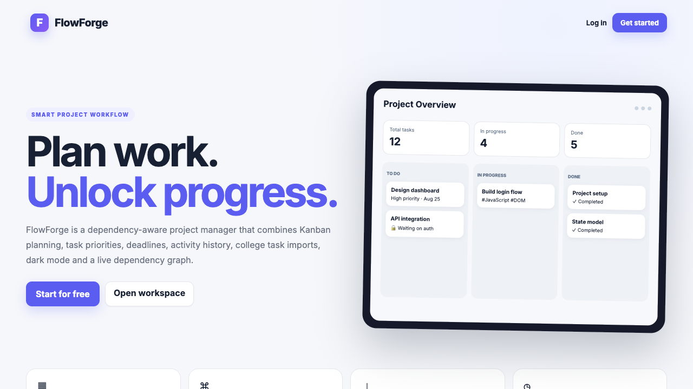
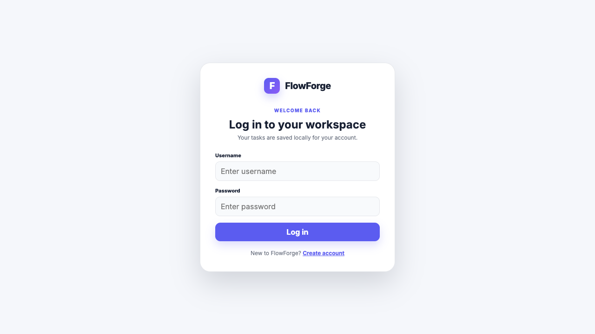
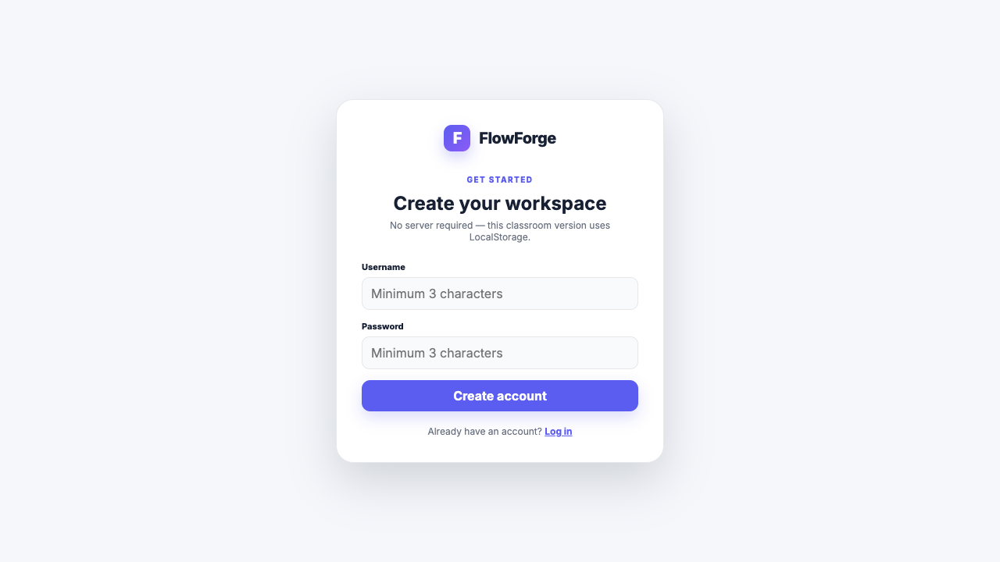
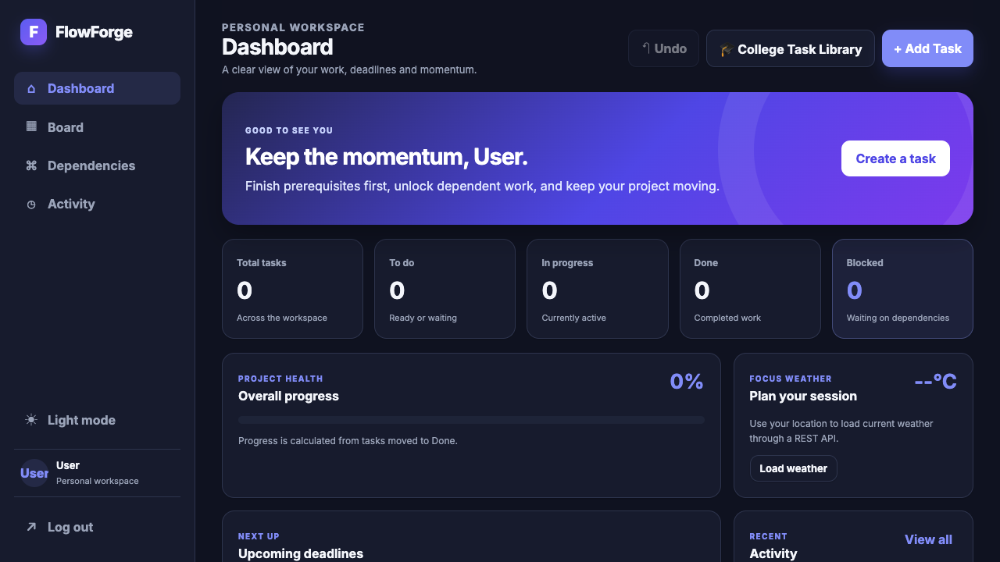
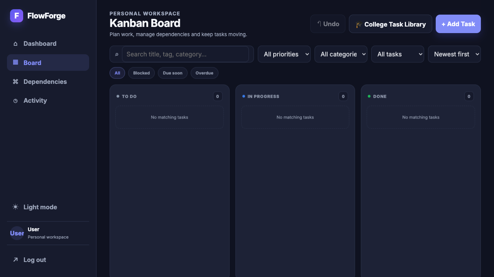
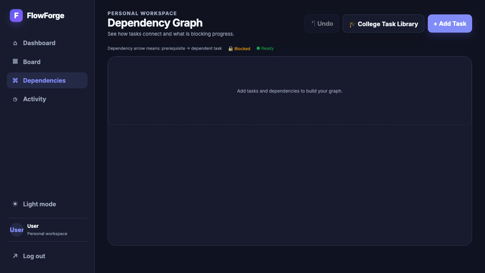
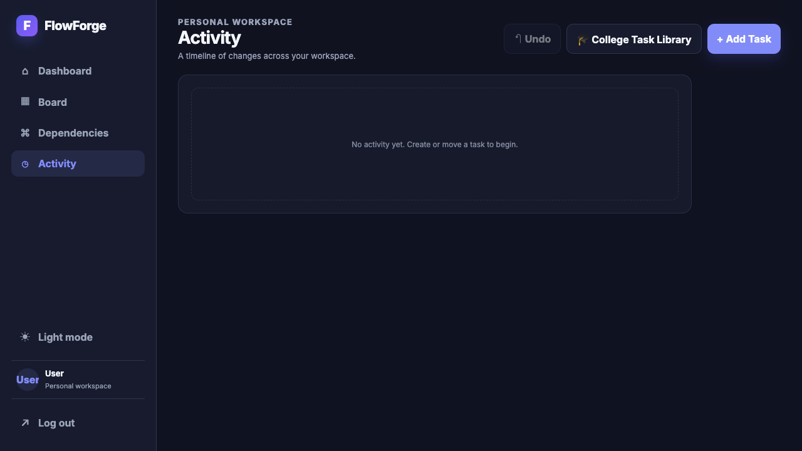

# FlowForge — Smart College Task & Dependency Manager

FlowForge is one college project spanning both evaluations: a Vanilla HTML/CSS/JavaScript workspace extended with Node.js, Express and MongoDB.

## Current setup and assessment

- [Setup and MongoDB Atlas](docs/setup-atlas.md)
- [Evaluation 2 syllabus mapping and demo guide](docs/evaluation-2-assessment.md)
- [Live integration test evidence](docs/api-integration-tests.md)
- [Database Studio](docs/database-studio.md) and [Postman collection guide](docs/postman.md)

Use Node 26 (tested with 26.5), run `npm ci`, configure `.env` following the setup
guide, and run `npm run dev`. Open http://127.0.0.1:3000/ or
http://127.0.0.1:3000/studio.html. Keep that terminal running and use another tab
for Git commands. Do not use the old static preview for backend features.

**Current integration boundary:** signup/login, board tasks and recent activity
use the authenticated MongoDB APIs shared with Database Studio. Create/edit/move/
delete and College Task Library imports save to the database. Older browser data
can be previewed and explicitly imported; originals are preserved. Undo restores
the latest task action for boards up to 500 tasks. Reset and library imports are
transactional. Each task's Files button supports
upload, download and removal. Deployment remains unfinished.
The feature descriptions below include the preserved Evaluation 1 functionality.

The project extends a traditional Kanban board into a smart workspace designed especially for college students. It allows students to organize assignments, exams, labs, coding practice, project work, presentations, and other academic tasks while managing priorities, deadlines, and task dependencies.

The application preserves DFS-based cycle detection and dependency locking while adding a dashboard, College Task Library, activity tracking, filters, weather information, themes, and other productivity features.

---

## Evaluation 1 handoff

See [the assessment guide](docs/evaluation-1.md) for lecture coverage, demo steps, validation status, and the Evaluation 2 boundary.

## Features

- Productivity dashboard with:
  - Total tasks
  - To Do tasks
  - In Progress tasks
  - Completed tasks
  - Blocked tasks
  - Overall progress percentage
  - Upcoming deadlines

- Kanban Board with:
  - To Do
  - In Progress
  - Done

- Create, edit and delete tasks

- Drag-and-drop task movement between columns

- Four task priorities:
  - Low
  - Medium
  - High
  - Urgent

- Custom task categories

- Due dates and deadline tracking

- Comma-separated task tags

- Search tasks by title, description, category or tags

- Filter tasks by:
  - Priority
  - Category
  - Blocked
  - Due soon
  - Overdue

- Sort tasks by:
  - Recently created
  - Oldest created
  - Due date
  - Priority
  - Title

- Dependency-based task locking

- DFS (Depth First Search) cycle detection to prevent circular dependencies

- Visual Dependency Graph showing relationships between tasks

- Activity history for:
  - Task creation
  - Editing
  - Movement
  - Deletion
  - College task imports

- Undo support for recent state-changing operations

- Light and Dark themes stored using LocalStorage

- Per-user task storage

- College Task Library for importing predefined academic tasks

- Weather information using the Open-Meteo REST API

- Existing Kanban user data migration support

---

## College Task Library

FlowForge includes a College Task Library designed specifically for students.

Instead of displaying random generic tasks, the library contains academic tasks such as:

- Complete DSA Assignment
- Prepare JavaScript CA
- Revise DNN Notes
- Submit CNDC Lab File
- Prepare Viva Questions
- Complete LeetCode Practice
- Prepare Project Presentation
- Finish Project Documentation

The task library is stored in:

```text
data/student-tasks.json
```

JavaScript loads the JSON data using the Fetch API and Async/Await:

```javascript
const response = await fetch('./data/student-tasks.json');
const data = await response.json();
```

Students can select one or multiple tasks from the library and import only the selected tasks into their Kanban board.

Each imported task can contain:

```text
Title
Description
Course
Category
Priority
Tags
```

This demonstrates Fetch API usage, Async/Await, JSON handling, array methods, DOM manipulation, and LocalStorage integration.

---

## Weather REST API

FlowForge also demonstrates consumption of a real external REST API using Open-Meteo.

The application obtains the user's location through the browser Geolocation API and sends the latitude and longitude to Open-Meteo.

The weather feature demonstrates Promise chaining:

```javascript
fetch(url)
    .then(response => response.json())
    .then(data => {
        // Process weather information
    })
    .catch(error => {
        // Handle errors
    })
    .finally(() => {
        // Final operation
    });
```

This allows the project to demonstrate both major asynchronous JavaScript approaches:

```text
College Task Library → Fetch + Async/Await + JSON
Weather API          → Fetch + Promises + REST API
```

---

# Task Dependency System

One of the main features of FlowForge is dependency-based task management.

A task can depend on another task.

For example:

```text
Complete Backend
       ↓
Test API
       ↓
Prepare Project Demo
       ↓
Prepare Viva
```

If a prerequisite task is incomplete, the dependent task can remain blocked.

This helps students organize project workflows where some tasks must be completed before others.

---

## DFS Cycle Detection

FlowForge uses Depth First Search (DFS) to prevent circular dependencies.

For example, the following dependency is invalid:

```text
Task A → Task B
Task B → Task C
Task C → Task A
```

This would create a cycle.

Before adding a dependency, FlowForge traverses the dependency graph using DFS. If the new dependency would create a cycle, the application prevents it.

This demonstrates the practical use of graph traversal algorithms in a web application.

---

# JavaScript Syllabus Coverage

FlowForge demonstrates concepts from the JavaScript syllabus through practical features.

### Variables, Data Types and Operators

Used throughout the application for storing tasks, filters, states, priorities, IDs, and configuration values.

### Conditionals

Used for:

- Task locking
- Priority handling
- Deadline detection
- Weather interpretation
- Authentication
- Form validation

### Loops and Functions

Used throughout rendering, state management, dependency traversal, filtering, and task operations.

### Arrays and Array Methods

The project uses:

```javascript
map()
filter()
forEach()
sort()
slice()
includes()
```

These are used for task rendering, searching, filtering, sorting, imports, activities, and dependencies.

### Objects and JSON

Tasks and application state are represented using JavaScript objects.

JSON is used for:

- College Task Library
- LocalStorage serialization
- API responses

### DOM Manipulation

JavaScript dynamically updates:

- Kanban cards
- Dashboard metrics
- Modals
- Filters
- College Task Library
- Dependency graph
- Activity history
- Weather information

### Events

The application uses:

- `click`
- `submit`
- `input`
- `change`
- Drag and drop events

It also uses:

```javascript
preventDefault()
```

for form handling.

### Forms and Validation

Forms are used for:

- Login
- Signup
- Creating tasks
- Editing tasks

Input validation prevents invalid or incomplete data.

### LocalStorage

LocalStorage stores:

- Registered users
- Login session
- Tasks
- Task activities
- Theme preference

Each user receives a separate task workspace.

### ES6 Features

The project uses modern JavaScript features including:

- ES Modules
- `import` / `export`
- `let` and `const`
- Arrow functions
- Template literals
- Spread syntax
- Destructuring
- Default values

### Callbacks

Callbacks are used for:

- Event listeners
- State subscribers
- Geolocation
- Array operations

### Promises

The weather API demonstrates:

```javascript
.then()
.catch()
.finally()
```

### Async/Await

The College Task Library demonstrates:

```javascript
async function
await fetch()
await response.json()
```

### Fetch API

Fetch is used in two different scenarios:

```text
student-tasks.json → College Task Library
Open-Meteo API     → Live weather information
```

### REST API Consumption

Open-Meteo provides the external REST API integration used by the weather feature.

### JSON Handling

JSON data is parsed and converted into JavaScript objects before being displayed or stored.

---

# Application Workflow

```text
User
 │
 ▼
Login / Signup
 │
 ▼
Dashboard
 │
 ├──────────────► College Task Library
 │                       │
 │                       ▼
 │               student-tasks.json
 │                       │
 │                       ▼
 │                Select Tasks
 │                       │
 │                       ▼
 │                  Import Tasks
 │
 ▼
Kanban Board
 │
 ├── To Do
 ├── In Progress
 └── Done
 │
 ▼
Task Dependencies
 │
 ▼
DFS Cycle Detection
 │
 ▼
Dependency Locking
 │
 ▼
Dependency Graph
 │
 ▼
LocalStorage
```

---

# Project Structure

```text
FlowForge/

├── index.html
├── login.html
├── signup.html
├── board.html
├── css/
│   └── styles.css
│
├── data/
│   └── student-tasks.json
│
├── docs/
│   ├── FlowForge.pptx
│   └── screenshots/
│
└── js/
    ├── api.js
    ├── app.js
    ├── auth.js
    ├── dashboard.js
    ├── dragdrop.js
    ├── graph.js
    ├── graphView.js
    ├── render.js
    ├── state.js
    ├── taskForm.js
    ├── theme.js
    └── toast.js
```

---

# Running the Project

Because FlowForge uses ES6 modules and the Fetch API, it should be served through a local web server rather than opening the HTML files directly.

## Using Python

Open a terminal inside the project directory:

```bash
cd FlowForge
```

Start the server:

```bash
python3 -m http.server 4173 --bind 127.0.0.1
```

Then open:

```text
http://127.0.0.1:4173
```

in your browser.

## Using VS Code

Install the **Live Server** extension and launch `index.html` using Live Server.

---

# Data Storage

The Evaluation 1 board currently uses browser LocalStorage. Evaluation 2 backend APIs and Database Studio use MongoDB; the board has not yet been switched to those APIs.

This allows the project to demonstrate client-side persistence while remaining within a Vanilla JavaScript architecture.

Task data is stored separately for each logged-in user.

Example:

```text
flowforge-board-username
```

Because the data is stored locally, it is specific to that browser/device.

---

# Authentication Note

Authentication is simulated on the client side using LocalStorage.

This approach is intentionally used to keep the application within the current JavaScript syllabus.

It is appropriate for:

- College demonstration
- JavaScript learning
- Academic projects
- Local personal use

Signup/login now use the Evaluation 2 bcrypt and JWT cookie API. Existing Evaluation 1 browser accounts are not database accounts; register through the updated signup page. Legacy browser data is preserved but is not automatically imported.

---

# Technologies Used

```text
HTML5
CSS3
Vanilla JavaScript
ES6 Modules
Fetch API
Open-Meteo REST API
JSON
LocalStorage
Geolocation API
Drag and Drop API
DFS / Graph Traversal
```

---

# Purpose

FlowForge demonstrates how core JavaScript concepts and data-structure concepts can be combined to build a practical application.

Rather than being only a basic Kanban board, it combines:

```text
Task Management
      +
College Productivity
      +
JavaScript Concepts
      +
REST API Integration
      +
LocalStorage
      +
Graph / DFS Logic
      =
FlowForge
```

The application can be used both as a classroom JavaScript project and as a personal college task-management tool.

---

# Screenshots

These are original Evaluation 1 reference screenshots; they predate the enhanced interface.








# Hosting preparation

Netlify support is included; the site is not yet deployed. See
[Atlas and Netlify steps](docs/netlify-deployment.md). Run `npm run build` and
`npm run test:hosting` to check the public build and serverless adapter locally.
The hosting test uses an isolated local MongoDB replica set.
